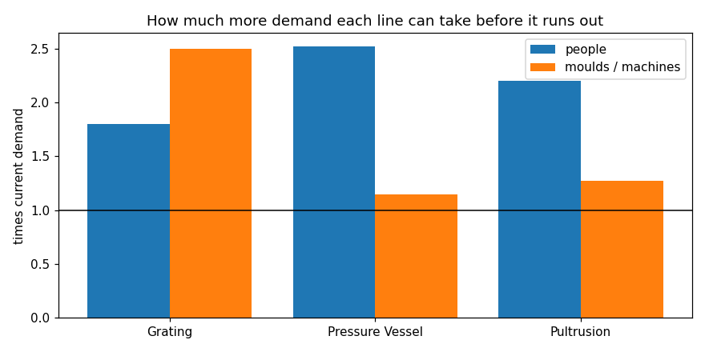

# Demand Forecasting and Capacity Planning - FRP Plant

Forecasting monthly demand for three production lines and checking whether the plant has enough people and moulds/machines to make it. Python (pandas, matplotlib) in one Jupyter notebook.

**In short:**
- **Pressure vessels** are the tightest line - the moulds are about 87% used and only ~15% more demand fits. Hiring won't help; moulds are the limit.
- **Pultrusion** runs out of machines first on the standard hours, but on the actual machine-log hours its people are already at their limit.
- **Grating** has room - about 56% labour utilisation.
- The plant's standard hours are out of date: actual hours are 1.8x the standard on vessels and 2.2x on pultrusion.

## The question

If orders keep coming in at the current rate, which line runs out of capacity first - and is it because of **people** or because of **moulds and machines**? This matters because the fix is different. If people are the limit you can hire or give overtime. If moulds are the limit, hiring does nothing.

The plant has three lines:
- **Pressure vessels** - hand lay-up on moulds
- **Pultrusion** - profiles pulled on machines
- **Moulded grating** - panels made on moulds

## Data

**Based on real data from an FRP plant, masked.** Company, customer and employee names, prices, PO and job numbers are all made up, and the plant figures (machine count, line speed, plank length, purge settings) are changed. The rows are rebuilt from the masked figures, so no row is a real record.

- `o2c.db` - the order book from my [Order-to-Cash SQL project](https://github.com/kousanidas/order-to-cash-sql), built from the profile of the plant's order register. I pull monthly order lines from it with SQL.
- `Production_Tracker_RAW.xlsx` - the kind of production tracker I maintain at work: daily production, manpower, machine log, standard hours and a job list, with the same kind of data-entry mess (13 spellings of the line name, three date formats, units typed into the quantity column, month totals inside the data).
- `Project2_Data_Collection.xlsx` - every number the analysis uses, tagged **MEASURED (masked)**, **CALCULATED**, **PUBLIC** or **ASSUMPTION** so measured and assumed values stay separate. Also a source log (which plant records were used and how they were masked), the pultrusion and capacity calculations, a list of gaps, the public sources with links, and an AI disclosure.

## What I did

1. **Demand** - counted order lines per line per month from the order book (29 months), leaving out cancelled orders and pultruded grating (sold under Grating but made on the pultrusion line, and not in the tracker). I didn't use ordered quantity because it isn't realistic for vessels in that database (median 13.5 vessels per order line, max 2,443).
2. **Forecast** - backtested four simple methods (last month, 3- and 6-month average, overall mean) on the last 17 months. The mean won for grating and pultrusion; for vessels the 6-month average and the mean were basically tied, so I took the 6-month average because it gives the higher (safer) number.
3. **Cleaning** - fixed line names, dates, item names and quantities in the tracker, moved back 11 quantities that were typed into the Size column, and dropped 1 row that couldn't be recovered.
4. **Hours needed vs available** - converted the forecast into standard hours using the tracker, and compared it with the hours people are actually present (after absence and a 16% allowance for breaks and delays).
5. **Mould and machine limits** - how many units the moulds and machines can physically make in a month. For vessels I worked out from the tracker that a mould is held for about 6.6 days per vessel.
6. **Scenarios** - demand +15%, 2 people fewer, overtime, and a lower/higher share of productive time.
7. **Standard hours vs actual** - compared the Std Hours sheet with the hours in the machine log.
8. **Checks** - 11 data checks, all passing.

## Results

| line | labour utilisation | can take before people run out | can take before moulds/machines run out | runs out first |
|---|---|---|---|---|
| Grating | 55.7% | 1.80x demand | 2.50x | **people** |
| Pressure Vessel | 39.7% | 2.52x | 1.15x | **moulds** |
| Pultrusion | 45.5% | 2.20x | 1.27x | **machines** |



- **Vessels are the tightest line, and the limit is moulds.** At the forecast demand the moulds are about 87% used, so only about 15% more demand fits. Hiring won't help - more moulds, or less time on each mould, would.
- **Pultrusion runs out of machines first on the standard hours** - but see below.
- **Grating has room.** People run out first, but only at about 1.8x today's demand.

### The standard hours are out of date

| line | actual / standard hours |
|---|---|
| Pressure Vessel | 1.77x |
| Grating | 0.92x |
| Pultrusion | 2.19x |

For vessels most of the gap is the crew. The Std Hours sheet assumes 2 people per mould ("2 man x 8 hr x ~1.6 day"), but the vessel department runs 3. In mould hours the two are only 18% apart (27.3 vs 32.2 hours per vessel).

Pultrusion is different: both sides are machine hours, so the line really takes about twice as long as the standard says. If the actual hours are right, the pultrusion people are already at their limit (1.0x) and run out before the machines. So for pultrusion the Std Hours sheet has to be fixed before deciding whether to add people or machines.

### Scenarios

No line goes over 100% in any scenario. Grating is the highest: 78% if it loses 2 people, 64% with 15% more demand. Pultrusion goes up to 59% and vessels to 47% - but these scenarios only move labour, and labour isn't what limits those two lines.

## How this was made

I set the scope, supplied the plant data and the domain knowledge, decided what had to be masked and reviewed the results. The code, the workbook formulas and the first drafts of the write-up were done with an AI assistant (Claude). The full split - and the errors that were caught along the way - is on the **AI disclosure** sheet in `Project2_Data_Collection.xlsx`.

## Limitations

- The data is masked and the rows are rebuilt, so the numbers describe a model of the plant, not its actual results. The method is the point.
- 29 months is short, and the order book has no trend or season, so a simple average was always likely to win.
- One shift a day is my assumption. Two shifts would roughly double the people limit.
- The forecast errors are big (50-75% MAPE) because the counts are small - about 3 to 9 order lines a month per line.
- Pultruded grating is left out, so the pultrusion load is a bit understated.
- 4 hours a week of overtime is about 52 hours a quarter, already over the 50 hour cap in the Factories Act. The new labour code may have changed this; I still need to check.

## How to run

```
pip install -r requirements.txt
jupyter notebook capacity_planning.ipynb
```

Run all cells. The notebook reads `o2c.db`, `Production_Tracker_RAW.xlsx` and `Project2_Data_Collection.xlsx` from the same folder, saves the charts (`.png`) and the cleaned tables (`.csv`, for a Power BI dashboard) in the same folder.

## Files

| file | what it is |
|---|---|
| `capacity_planning.ipynb` | the whole analysis |
| `Production_Tracker_RAW.xlsx` | messy production tracker (masked) |
| `Project2_Data_Collection.xlsx` | source log, parameters (measured / calculated / public / assumed), calculations, gaps, sources, AI disclosure |
| `o2c.db` | order book from my Order-to-Cash project |
| `capacity.png`, `demand.png`, `scenarios.png` | charts |
| `capacity_summary.csv`, `monthly_order_lines.csv`, `production_clean.csv`, `scenarios.csv`, `std_vs_actual.csv` | cleaned data and results (feed for a Power BI dashboard) |
